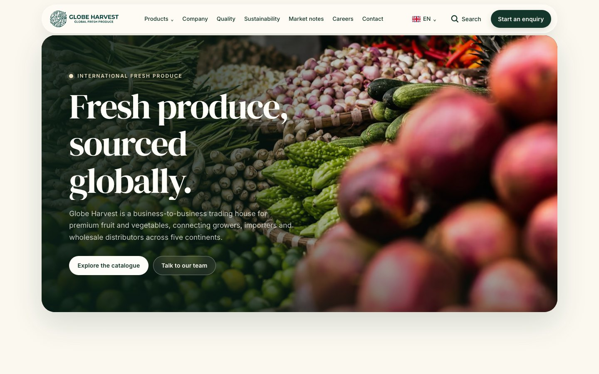
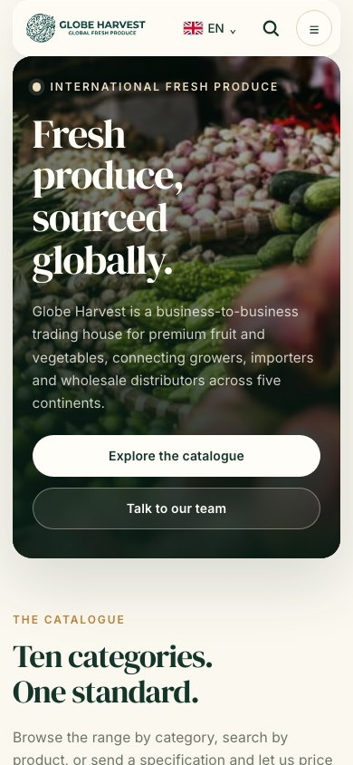
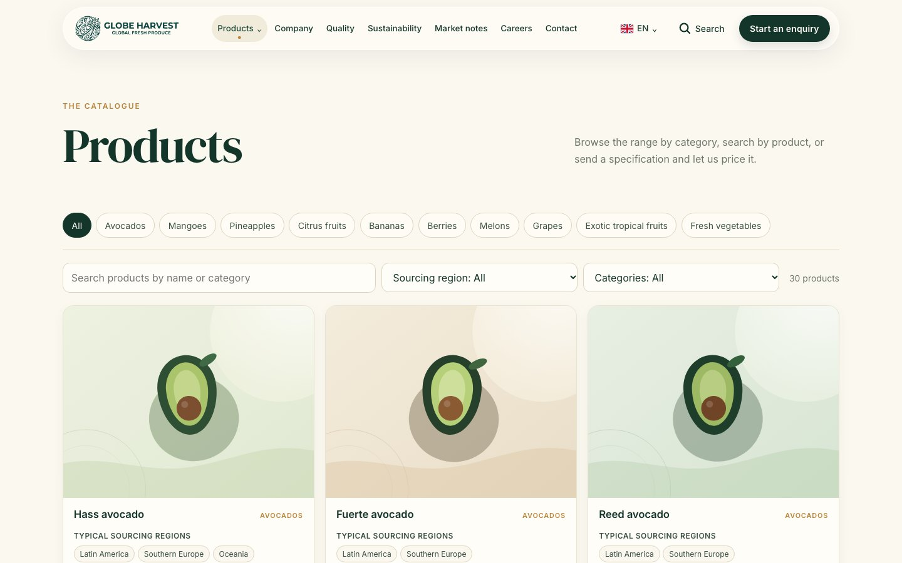
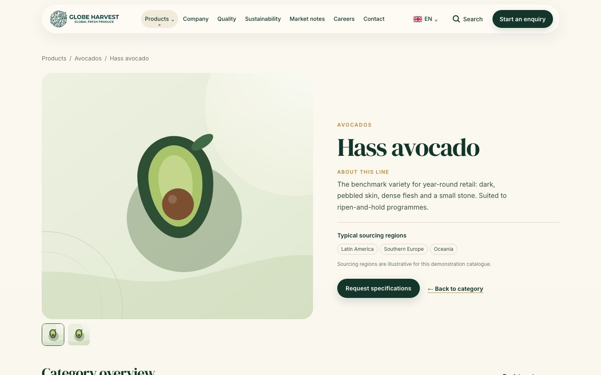
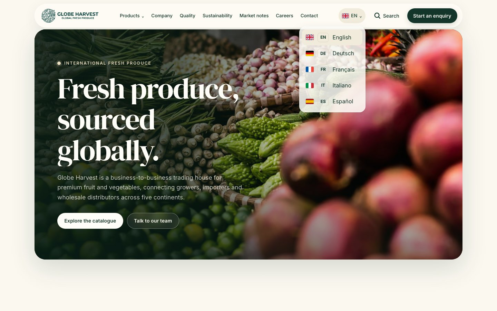

# Globe Harvest

Globe Harvest is a modern multilingual fresh-produce trading and catalogue
website. It presents a ten-category B2B produce portfolio, editorial company and
quality pages, illustrative market notes and a validated buyer-enquiry form in
English, German, French, Italian and Spanish.

Globe Harvest is an independently created demonstration brand. It is **not** an
official website of PPO, a producer organisation or any other existing company,
and it is not affiliated with or endorsed by one. The business, products,
sourcing regions and market notes are illustrative rather than records of live
trading.

> **Status:** demonstration product, not an operating company. There are no real
> customers, supplier relationships, export volumes, certifications, revenue or
> production traffic. The contact form remains disabled until the operator
> configures a delivery endpoint.

## Screenshots

| Homepage — desktop | Homepage — mobile |
| --- | --- |
|  |  |

| Product catalogue | Product detail |
| --- | --- |
|  |  |



The screenshots are stored under `docs/screenshots/` and reflect the current
demonstration content at a 1440 px desktop width and a 390 px mobile width.

## Features

- **Responsive homepage** with editorial photography, category navigation,
  company information, value section, featured lines and an enquiry call to action.
- **Catalogue of 10 categories and 30 products**, covering avocados, mangoes,
  pineapples, citrus, bananas, berries, melons, grapes, tropical fruit and vegetables.
- **Product search and filtering**: client-side search by product or category,
  sourcing-region filter, category filter and shareable category URLs.
- **Product detail pages** with original SVG artwork, localized description,
  sourcing-region labels and a specification-request link.
- **Five complete language versions** for navigation, UI, catalogue copy, editorial
  pages, market notes and form labels.
- **Contact form** with server-side Zod validation, honeypot, request-size limits,
  origin check, attachment type/signature checks and an explicit demonstration mode.
- **Navigation** with a product mega-menu, search dialog, accessible mobile drawer
  and language switcher that preserves the current route.
- **SEO foundations**: localized titles and descriptions, canonical URLs, hreflang
  alternates, sitemap, robots rules, Open Graph/Twitter metadata and a generated
  social image.
- **Responsive, accessible UI** with a skip link, keyboard-operable menus, visible
  focus styles and reduced-motion support.
- **Brand and loading surfaces**: supplied logo lockups, favicon/app icons, a branded
  loading screen and 404/error states.
- **No database, CMS, analytics, payment or e-commerce checkout.** This is an
  information and enquiry website, not an online shop.

## Technology stack

| Area | Implementation |
| --- | --- |
| Framework | Next.js 16.4 (App Router; resolved at 16.4.4 in the lockfile) |
| UI runtime | React 19.3.1 and React DOM 19.3.1 |
| Language | TypeScript 5.9.3 with `strict: true` |
| Build | Next.js/Turbopack production build |
| Styling | Plain CSS with custom properties and per-surface stylesheets; no UI framework |
| Routing | App Router catch-all locale route in `src/app/[locale]/[[...segments]]/page.tsx`; locale resolution in `src/proxy.ts` |
| Internationalisation | Typed dictionaries in `src/lib/i18n/`; localized JSON content in `src/data/` |
| Validation | Zod 4.6.7, server-side in the contact API |
| Linting | ESLint 9 with `eslint-config-next` core-web-vitals and TypeScript rules |
| Images | `next/image` for local JPEG photography and SVG artwork |
| Fonts | DM Serif Display and Inter, loaded from Google Fonts CSS (SIL OFL 1.1) |
| Testing | No automated test framework is configured |
| Deployment | Vercel (recommended) or any Node.js host able to run Next.js |

Versions above reflect `package-lock.json`. Use `npm ci` for a reproducible install.

## Supported languages

| Code | Language | Default |
| --- | --- | --- |
| `en` | English | Yes |
| `de` | German | |
| `fr` | French | |
| `it` | Italian | |
| `es` | Spanish | |

Every content route exists under each locale prefix: `/en`, `/de`, `/fr`, `/it`
and `/es`. The root redirects to the default locale. Choosing a language keeps the
current path and survives refresh because the locale is part of the URL.

Translations are split between two systems:

- **Interface strings:** `src/lib/i18n/en.ts`, `de.ts`, `fr.ts`, `it.ts`, `es.ts`.
- **Structured content:** the `en`/`de`/`fr`/`it`/`es` fields inside each JSON file in
  `src/data/catalog`, `src/data/pages` and `src/data/news`.

The dictionaries are checked by TypeScript: every language must provide every key
defined by the English dictionary. JSON content is loaded at build time, but its
shape is not separately schema-validated, so review all five locale fields when
editing it.

## Prerequisites

- **Node.js 20.9 or newer.** This is the minimum declared by Next.js 16.
- **npm 10 or newer.** The repository uses npm lockfile version 3.
- **Git.**
- A code editor with TypeScript support, such as VS Code.

The project declares its runtime requirements in `package.json` under `engines`.
This release was verified locally with Node.js 25.9.0 and npm 11.12.1.

## Installation and onboarding

```sh
git clone YOUR_REPOSITORY_URL
cd globe-harvest
npm ci
cp .env.example .env.local
```

`npm ci` installs the exact dependency versions in `package-lock.json`. Use
`npm install` only when you intentionally change dependencies and need to update
the lockfile.

Open `.env.example` to see the server-side variables and their purpose. For a
local preview, the empty contact endpoint is intentional: the form runs in
demonstration mode. Set `SITE_URL` when you need correct canonical and sitemap URLs
for a deployed domain. Never commit `.env.local` or put the contact endpoint in a
`NEXT_PUBLIC_*` variable.

## Running locally

```sh
npm run dev
```

Open <http://localhost:3000>. The root URL redirects to `/en`. Stop the development
server with `Ctrl+C`.

Useful checks while developing:

```sh
npm run lint
npm run typecheck
```

## Production build

```sh
npm run build
npm run preview
```

`npm run build` creates the optimized Next.js output in `.next`. `npm run preview`
is an alias for `next start` and serves the production build on port 3000 by
default. Override the port with `PORT=3100 npm run preview` if needed.

`npm start` is also available for deployment platforms that expect that command.

## Environment variables

| Variable | Purpose | Required | Public or Secret | Consumer |
| --- | --- | --- | --- | --- |
| `SITE_URL` | Canonical origin for metadata, sitemap, robots and social URLs | Required in production | Public | `src/app/layout.tsx`, `sitemap.ts`, `robots.ts` |
| `BUSINESS_EMAIL` | Public contact email | Optional, recommended | Public | Footer and contact page |
| `BUSINESS_PHONE` | Public telephone number | Optional, recommended | Public | Footer and contact page |
| `BUSINESS_ADDRESS` | Public postal address, with line breaks | Optional, recommended | Public | Footer and contact page |
| `CONTACT_FORM_ENDPOINT` | Multipart endpoint that receives enquiries | Required for live delivery | Secret | `src/app/api/contact/route.ts` only |
| `SOCIAL_LINKEDIN_URL` | LinkedIn profile URL | Optional | Public | Footer, hidden when empty |
| `SOCIAL_INSTAGRAM_URL` | Instagram profile URL | Optional | Public | Footer, hidden when empty |

All variables are read on the server. The project does not use `NEXT_PUBLIC_*`.
Treat the form endpoint as private configuration even though the provider may
serve a public form: keeping it server-side prevents it from being copied into the
client bundle and gives you one place to rotate it.

For Vercel, add the same names under **Project → Settings → Environment
Variables** for Production, Preview and Development as appropriate. Redeploy after
changing them. Other Node hosts can inject the same variables through their
secret-management interface.

## Project structure

```text
.
├── docs/screenshots/              README preview images
├── public/
│   ├── art/                       Original generated catalogue and editorial SVGs
│   ├── brand/                     Supplied master logo, release lockups and icons
│   └── photos/                    Openly licensed homepage photography and credits
├── scripts/
│   └── generate-art.mjs           Catalogue/editorial SVG generator
├── src/
│   ├── app/
│   │   ├── [locale]/[[...segments]]/page.tsx   Localized route renderer
│   │   ├── api/contact/route.ts                Contact submission endpoint
│   │   ├── layout.tsx                           Root metadata, locale and splash
│   │   ├── manifest.ts                          Web app manifest
│   │   ├── opengraph-image.tsx                  Generated social image
│   │   ├── robots.ts / sitemap.ts               Crawl metadata
│   │   ├── page.tsx                             Root redirect
│   │   └── *.css                                Tokens, layout and page styles
│   ├── components/                 Header, footer, home, catalogue, forms, motion
│   ├── data/
│   │   ├── catalog/                Ten category JSON files, 30 products
│   │   ├── news/                   Three localized market notes
│   │   └── pages/                  Seven localized editorial/legal pages
│   ├── lib/
│   │   ├── content.ts              Content model and lookup helpers
│   │   ├── i18n/                   Five typed interface dictionaries
│   │   ├── photos.ts               Homepage photography mapping
│   │   └── site.ts                 Server-side environment configuration
│   └── proxy.ts                    Locale detection and redirects
├── .env.example                    Environment template with no real credentials
├── eslint.config.mjs               ESLint flat configuration
├── next.config.ts                  Next.js image and build configuration
├── package.json / package-lock.json
├── tsconfig.json
├── design.md                       Brand and design-system notes
├── LICENSING.md                    Code, asset and dependency licensing review
└── PHOTO-CREDITS.md                Photo authors, licences and sources
```

Generated folders such as `.next/`, `node_modules/` and coverage output are ignored
and are not part of the source release.

## Product catalogue management

Product data lives in `src/data/catalog/*.json`. Each file represents one category
and contains:

```json
{
  "id": "avocados",
  "names": { "en": "Avocados", "de": "Avocados", "fr": "Avocats", "it": "Avocado", "es": "Aguacates" },
  "description": { "en": "...", "de": "...", "fr": "...", "it": "...", "es": "..." },
  "image": "/art/avocados.svg",
  "products": [
    {
      "slug": "hass",
      "name": { "en": "Hass avocado", "de": "Hass-Avocado", "fr": "Avocat Hass", "it": "Avocado Hass", "es": "Aguacate Hass" },
      "note": { "en": "...", "de": "...", "fr": "...", "it": "...", "es": "..." },
      "image": "/art/avocados-hass.svg",
      "regions": ["latin-america", "southern-europe", "oceania"]
    }
  ]
}
```

### Add a product

1. Add an object to the relevant category's `products` array. Use a unique `slug`.
2. Provide `name` and `note` in all five locales.
3. Put the product illustration in `public/art/` and set `image` to its `/art/...`
   URL. The existing catalogue art follows `<category>-<slug>.svg`.
4. Use region keys from `RegionKey` in `src/lib/content.ts`.
5. Add the product artwork recipe to the appropriate `products` map in
   `scripts/generate-art.mjs` if you want `npm run art` to generate it, then run
   `npm run art`.
6. Run `npm run lint`, `npm run typecheck` and `npm run build`.

### Add or reorder a category

Create the JSON file, import it in `src/lib/content.ts`, and insert it into the
`categories` array. The array order controls the catalogue and homepage category
order. Category images and product images must exist under `public/art/`.

The product search and region/category filters are implemented client-side in
`src/components/ProductCatalog.tsx`. Category selection updates the route
`/products/:categoryId`, which makes filtered category views shareable. Search
matches the localized product and category names. Region labels are translated
keys defined in the five dictionaries.

The sourcing regions and product descriptions are illustrative demonstration
content. They are not supplier records or compliance claims.

## Translation management

UI strings live in `src/lib/i18n/`. To change the homepage heading:

```ts
// src/lib/i18n/en.ts
heroTitle: "Fresh produce, sourced globally.",
```

Update the same key in `de.ts`, `fr.ts`, `it.ts` and `es.ts`. The English dictionary
defines `TranslationKey`; the other dictionaries are typed as
`Record<TranslationKey, string>`, so a missing key fails `npm run typecheck` and a
new key must be added to all five files.

For structured content, update each localized field in the relevant JSON record:

```json
"title": {
  "en": "Company",
  "de": "Unternehmen",
  "fr": "Entreprise",
  "it": "Azienda",
  "es": "Empresa"
}
```

Keep all five fields present and review translations in context. JSON content does
not have a separate runtime schema check; the build will not catch a missing locale
variant for you. Region labels and form enquiry types also have entries in the
dictionaries.

To add a sixth language, update the `locales` array and `LocaleFlag`/language-name
maps, add the dictionary, update the proxy's supported list, and add the locale to
the metadata/OG locale maps. Search `locales`, `languageNames` and `supportedLocales`
for the complete set of touchpoints.

## Contact form configuration

The form component posts multipart form data to `/api/contact`. The route:

- validates fields with Zod;
- rejects oversized requests before reading the full body;
- checks the request origin against the request host;
- uses a hidden honeypot field;
- allows up to four PDF, DOCX, PNG or JPEG attachments, with per-file and combined
  size limits and file-signature checks;
- forwards valid submissions to `CONTACT_FORM_ENDPOINT` only on the server.

With `CONTACT_FORM_ENDPOINT` empty, the site is in **demonstration mode**. The form
shows a visible notice, the submit button is disabled, and the API returns HTTP 503
rather than pretending that an enquiry was delivered.

To connect a provider:

1. Create a form with a provider that accepts `multipart/form-data` (for example a
   Formspree form or your own endpoint).
2. Set `CONTACT_FORM_ENDPOINT` in `.env.local` **only** for local testing, or in the
   hosting provider's secret settings for deployment.
3. Never expose the endpoint through `NEXT_PUBLIC_*` and never paste a live endpoint
   into README examples or screenshots.
4. Test with a non-sensitive sample enquiry. Confirm the provider received it, then
   delete the sample data from the provider if appropriate.
5. Check the demo notice disappears, the button becomes enabled and failures show a
   non-success message.

The repository does not contain a live endpoint.

## Deployment to Vercel

1. Create a new GitHub repository for the cleaned Globe Harvest source tree.
2. In Vercel, choose **Add New → Project** and import the repository.
3. Select the **Next.js** framework preset. Set the install command to `npm ci`
   and the build command to `npm run build`. The output is handled automatically
   by Next.js.
4. Add the environment variables from the table above. At minimum set `SITE_URL`
   to the final `https://` domain. Add `CONTACT_FORM_ENDPOINT` only when the form is
   ready to deliver mail.
5. Deploy. Vercel will install dependencies and produce the production build.
6. Add the custom domain under **Settings → Domains**, update DNS as instructed,
   and set `SITE_URL` to the final canonical domain without a trailing slash.
7. Verify `/en`, `/de`, `/fr`, `/it` and `/es`, the catalogue, a product detail page,
   the language switcher, the contact demo state, `/sitemap.xml`, `/robots.txt`,
   `/manifest.webmanifest`, the icons and `/opengraph-image`.

For another Node host, use Node.js 20.9 or newer, install with `npm ci`, build with
`npm run build`, and run `npm start` behind the platform's process manager.

## Troubleshooting

| Problem | Check |
| --- | --- |
| Node version error during install or build | Run `node -v`; use Node 20.9+ and `npm ci` with the committed lockfile. |
| Dependency install fails | Remove `node_modules` and rerun `npm ci`; do not delete or hand-edit `package-lock.json`. Check registry access. |
| Missing environment variables | Copy `.env.example` to `.env.local`. `SITE_URL` is needed for correct production URLs; the form intentionally stays in demo mode without an endpoint. |
| Production build fails | Run `npm run lint` and `npm run typecheck` first. Remove `.next` and rebuild if the cache is corrupt. |
| Images or artwork are broken | Confirm the file exists under `public/` and the path starts with `/art/`, `/photos/` or `/brand/`. Paths are case-sensitive on Linux and Vercel. |
| A translation is missing or the wrong language appears | Check all five fields/keys; UI dictionary omissions fail typecheck. Confirm the URL locale and the dictionary key. JSON content needs manual review. |
| Contact form stays disabled | `CONTACT_FORM_ENDPOINT` is empty or the server did not receive it. Set it in the current environment and restart/redeploy. |
| Contact form returns a failure | Confirm the provider accepts multipart data, the endpoint is reachable, the request is under the size limit and the file signatures match the extensions. Check server logs for the provider status. |
| Deployment succeeds but canonical URLs are wrong | Set `SITE_URL` to the final domain and redeploy; rebuild the sitemap after changing it. |
| Fonts look different | The fonts are loaded from Google Fonts at runtime; check network access or replace the import in `src/app/tokens.css` with self-hosted OFL fonts. |

## Maintenance and development

```sh
git switch -c feat/short-description
npm ci
# make changes
npm run lint
npm run typecheck
npm run build
git add <files>
git commit -m "Describe the change"
git push -u origin feat/short-description
```

Open a pull request and include the checks you ran. Keep `.env.local`, provider
credentials, generated `.next` output and local screenshots out of commits. Run
`npm outdated` and `npm audit` deliberately; update one dependency group at a time,
then repeat lint, typecheck and build. Do not update major versions without reviewing
the Next.js and React migration notes.

There is no `npm test` script because no automated test framework is included.
Content and route checks are currently manual plus lint, strict TypeScript and the
production build. Adding a test runner is a sensible next step before a commercial
launch.

## Licensing and third-party assets

**The project's overall source-code licence has not been specified.** No `LICENSE`
file has been added, so do not assume that the code is MIT, open source or freely
redistributable. The package is marked `"private": true`. The owner must choose the
licence or sale terms before publishing a public repository.

- **Brand artwork:** `public/brand/logo2.svg` is the supplied master artwork and the
  other lockups/icons are derived from it. Its provenance and ownership must be
  confirmed by the owner before a public or commercial release. Do not describe it
  as third-party stock or claim rights that have not been verified.
- **Generated artwork:** the catalogue/editorial SVGs in `public/art` are produced by
  `scripts/generate-art.mjs` for this project. Their terms follow the project's
  (undecided) licence.
- **Photography:** `public/photos` contains CC0, CC BY-SA 2.5, CC BY-SA 3.0 and
  CC BY-SA 4.0 images. Credits and sources are in `PHOTO-CREDITS.md` and
  `public/photos/credits.json`. Keep the credits. CC BY-SA images carry attribution
  and share-alike obligations for adaptations; they cannot be sold on an exclusive
  basis. Replace them with commissioned photography if exclusivity is required.
- **Fonts:** DM Serif Display and Inter are loaded from Google Fonts and licensed
  under the SIL Open Font License 1.1. No font binaries are redistributed here.
- **Dependencies:** the direct runtime dependencies are MIT-licensed; TypeScript and
  the lint toolchain are permissively licensed. See `LICENSING.md` for the inventory
  and the obligations to review before a sale.

Read `LICENSING.md` before publishing. It is an engineering review, not legal advice.

## Project status

This is a complete demonstration website product, suitable as a starting point for
a buyer who will supply their own business details, photography, legal review and
contact delivery. It has not been operated as a real trading business and does not
claim real customers, suppliers, volumes, certifications, traffic or revenue. The
sourcing information, market notes and photography are illustrative or openly
licensed content, not evidence of commercial operations.

The application has been checked with lint, strict TypeScript and a production build.
No automated browser, accessibility or end-to-end test suite is included. The
contact form has not been verified against a live provider in this repository.

## Verification

```sh
npm ci
npm run lint
npm run typecheck
npm run build
```

For a quick production smoke test:

```sh
PORT=3100 npm run preview
```

Then open `/en`, `/en/products`, a product detail page and `/en/contact`. Check the
console for errors and confirm the demo-mode notice is visible when no endpoint is
configured.
